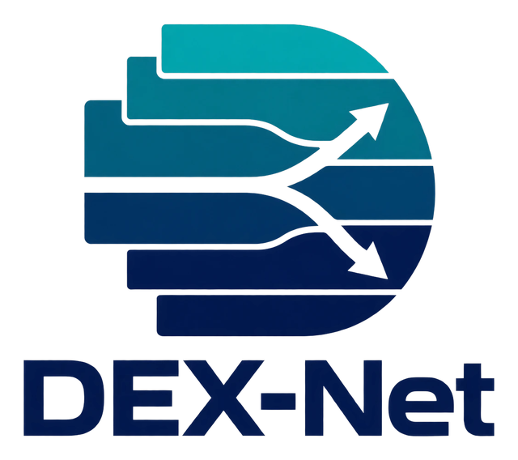
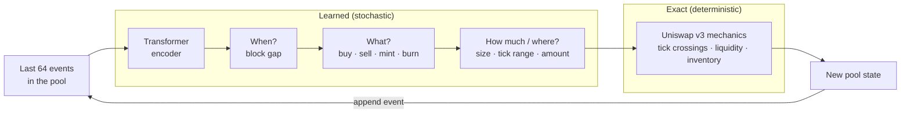

<div align="center">

<picture>
  <source media="(prefers-color-scheme: dark)" srcset="assets/logo-dark.png">
  
</picture>

### Simulate Uniswap v3 pools event by event, with exact pool mechanics.

[](LICENSE)
[](https://creativecommons.org/licenses/by/4.0/)
[](pyproject.toml)
[](https://pytorch.org)
[](#citation)

[Quickstart](#quickstart) · [How it works](#how-it-works) · [Pipeline](#full-pipeline) · [Data](#data) · [Citation](#citation)

</div>

---

## What is DEX-Net?

DEX-Net is a generative model of what happens inside a decentralized exchange pool. It writes a pool's future one event at a time: swaps, liquidity added, and liquidity removed.

- **Learns only what's random.** It predicts when the next event comes, what kind it is, how big it is, and where liquidity goes.
- **Computes the rest exactly.** Prices and liquidity come from real Uniswap v3 tick math, so every simulated path is a valid pool history.
- **One model, many pools.** A single 0.95M-parameter network is trained across ten Ethereum pools and tested on two pools it has never seen.

It also includes tools to measure what liquidity providers actually earn: fee income against the loss to arbitrageurs (LVR), swap by swap, on Ethereum, Arbitrum and Base.

## At a glance

| | |
|---|---|
| **Data** | 29.4M events from 10 Ethereum pools, May 2021 – Sep 2026 |
| **Exactness** | Reconstructed liquidity matches the chain at all 28.2M swaps |
| **Model** | 0.95M parameters · trains in ~9 hours on one consumer GPU |
| **Held-out test** | Two pools never used in training or tuning |
| **Economics** | 61M Arbitrum and Base swaps, verified against on-chain state |

## How it works



The model never predicts a price directly. It samples an order or a liquidity change, and the pool mechanics decide what that does to the price. If a sampled event is impossible, such as burning liquidity that doesn't exist, the path stops and is counted as a failure. It is never quietly fixed.

## Quickstart

```bash
git clone https://github.com/Claybarn/DEX-Net && cd DEX-Net
uv venv && uv pip install -e .
python -m unittest discover -s tests -t .
```

Dependencies are just `numpy`, `torch`, `pyarrow` and `pandas`. Training needs one GPU (CUDA or ROCm); everything else runs on a CPU.

Sample futures from a trained model at 64 test-period starting points:

```bash
python -m scripts.prepare_anchors --data data/prepared --out eval/anchors --split test --anchors 64 --horizons 32,128,512
python -m scripts.rollout_eval --anchors eval/anchors --out eval/rollouts --model ref=runs/ref/training/best.pt --paths 32
```

## Full pipeline

Every stage writes its own folder, refuses to overwrite finished work, and resumes after an interruption. RPC endpoints are read from environment variables and never written to disk.

<details>
<summary><b>1. Collect and prepare data</b></summary>

<br>

You need an Ethereum endpoint that serves historical logs and archive calls.

```bash
export DEXNET_RPC_URLS=https://your-endpoint      # comma-separated for rotation
python -m scripts.collect_logs    --out data/raw
python -m scripts.collect_headers --out data/headers
python -m scripts.prepare_data    --raw data/raw --headers data/headers --out data/prepared
python -m scripts.prepare_context --data data/prepared --out data/context
python -m scripts.audit_mechanics --data data/prepared --out data/mechanics-audit
```

- **Replay check:** `prepare_data` replays every event through an exact-integer liquidity ledger. It requires the result to match the chain's reported liquidity at every swap, and checks the block-header hash chain.
- **Splits:** it builds chronological train, validation and test splits.
- **Scalers:** fitted on training data from the eight training pools only.
- **Held-out pools:** USDC/USDT 0.05% and WBTC/WETH 0.3% are kept entirely out of training and tuning.

</details>

<details>
<summary><b>2. Train the event model</b></summary>

<br>

```bash
python -m scripts.prepare_training --data data/prepared --context data/context --out runs/ref --seed 260930
python -m scripts.train --out runs/ref --smoke     # optional quick GPU check
python -m scripts.train --out runs/ref
```

Reference model:

- **Size:** width 128, 4 layers, 4 heads, a 64-event context.
- **Training:** 3 pool-balanced epochs (202M examples) with AdamW, peak learning rate 1e-4, warmup then cosine decay.
- **Selection:** validation picks `best.pt`, which is then scored on the test and held-out pools.
- **Seeds:** 260930, 260931 and 260932.

</details>

<details>
<summary><b>3. Evaluate rollouts</b></summary>

<br>

```bash
python -m scripts.prepare_anchors --data data/prepared --out eval/anchors-test --split test --anchors 64 --horizons 32,128,512
python -m scripts.rollout_eval --anchors eval/anchors-test --out eval/rollouts-test \
    --model ref=runs/ref/training/best.pt --paths 32 --workers 8
```

- **Starting points:** spaced evenly through the test period and never chosen by outcome. Each one's exact pool state is rebuilt from the raw log.
- **Scored outcomes:** price return, liquidity change, elapsed blocks and volume.
- **Scores:** energy score, CRPS, bias and 90% interval coverage.
- **Saved output:** every simulated path, for further analysis.

</details>

<details>
<summary><b>4. Direct baseline</b></summary>

<br>

A non-recursive model that forecasts price and volume straight at 5 minutes, 30 minutes, 2 hours and 6 hours.

```bash
python -m scripts.prepare_direct_labels --data data/prepared --out runs/direct/labels
python -m scripts.train_direct --data data/prepared --labels runs/direct/labels --out runs/direct/seed1
```

</details>

<details>
<summary><b>5. LP economics: fees vs. LVR</b></summary>

<br>

```bash
python -m scripts.fetch_binance --symbol ETHUSDT --months 2025-09:2026-09 --out data/cex
python -m scripts.collect_protocol_fees --data data/prepared --out data/protocol
python -m scripts.fee_lvr --data data/prepared --out results/fee-lvr --protocol-dir data/protocol \
    --cex data/cex/ethusdt_1s.parquet --cex-pools USDC-WETH-500,USDC-WETH-3000,USDT-WETH-500,USDT-WETH-3000
DEXNET_RPC_URL_BASE=... python -m scripts.collect_l2_swaps --chain base --out data/l2
DEXNET_RPC_URL_BASE=... python -m scripts.verify_l2_swaps  --chain base --out data/l2
python -m scripts.l2_fee_lvr --l2 data/l2 --cex data/cex/ethusdt_1s.parquet --mainnet results/fee-lvr --out results/l2
python -m scripts.timing_ceiling --data data/prepared --protocol-dir data/protocol --l2 data/l2 \
    --cex data/cex/ethusdt_1s.parquet --out results/ceiling.json
python -m scripts.hourly_gate --ledgers results/fee-lvr --out results/gate
```

- **Fees:** `fee_lvr` measures each swap's exact fee income for in-range liquidity, net of the protocol fee where its history is given.
- **Losses:** it also measures each swap's loss to better-informed traders, valued against later pool prices or Binance. Summed per block, that loss is LVR.
- **Timing ceiling:** `timing_ceiling` finds the most any perfectly informed in/out strategy could earn at decision intervals from one block to one day, after entry costs.

</details>

## Repository layout

```
dexnet/     the library: v3 tick math, event dataset, model, sampler, scores, LVR accounting
scripts/    one command per pipeline stage (python -m scripts.<name>)
tests/      unit tests, including exact-mechanics and synthetic LVR checks
paper/      paper source and outline
assets/     logo (light and dark variants)
```

## Data

The reconciled per-pool event data, the Arbitrum and Base swap collections, and the reference checkpoints will be released with the paper under **CC BY 4.0**. Everything comes from public blockchain records. Binance prices aren't redistributed; `scripts.fetch_binance` downloads them from Binance's public archive and checks them against its published checksums.

## Citation

```bibtex
@misc{barnes2026dexnet,
  title  = {DEX-Net: A Mechanics-Grounded Generative Model of Uniswap v3 Order Flow},
  author = {Barnes, Clayton},
  year   = {2026},
  note   = {arXiv preprint}
}
```

## License

Code is released under the [Apache License 2.0](LICENSE). Data is released under [CC BY 4.0](https://creativecommons.org/licenses/by/4.0/).
